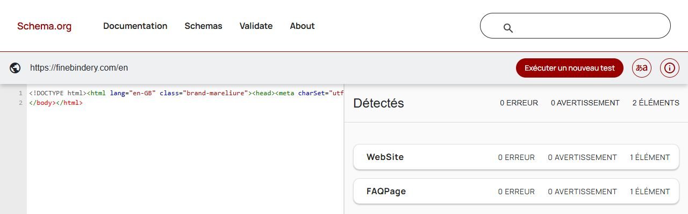

# Données structurées en ligne — 20 octobre 2026, soir

**Aucune erreur ni avertissement Schema.org sur les huit URL demandées.** Les six pages par besoin contiennent chacune un DefinedTermSet, une FAQPage et un BreadcrumbList : 54 termes et 37 questions au total. Le test Google reconnaît un fil d’Ariane valide sur les sept pages françaises ; il ne détecte aucun résultat enrichi sur l’accueil anglais.

Relevé des JSON-LD par GET public, tous HTTP 200, puis validation par URL dans [Schema.org](https://validator.schema.org/) et [le test Google](https://search.google.com/test/rich-results), sur smartphone. Les tableaux décrivent le contenu effectivement servi, pas le seul code local. Les heures UTC, empreintes HTML, JSON-LD et liens des verdicts sont dans [les preuves](structured-data-20261020/results.json). Base de la branche documentaire : origin/main abfe72b.

| Page | Termes | Questions FAQ | Schema.org erreurs / avertissements | Google |
| --- | ---: | ---: | ---: | --- |
| [mareliure.fr/reparation-de-livres](https://mareliure.fr/reparation-de-livres) | 9 | 6 | 0 / 0 | [1 fil d’Ariane valide détecté](https://search.google.com/test/rich-results/result?id=px4aZVZYFWbuleKe6HEuoA) |
| [mareliure.fr/restauration-de-livres-anciens](https://mareliure.fr/restauration-de-livres-anciens) | 10 | 7 | 0 / 0 | [1 fil d’Ariane valide détecté](https://search.google.com/test/rich-results/result?id=CYtZAOShpeRZks9GqOGjHQ) |
| [mareliure.fr/reliure-de-livres](https://mareliure.fr/reliure-de-livres) | 10 | 6 | 0 / 0 | [1 fil d’Ariane valide détecté](https://search.google.com/test/rich-results/result?id=gI87Dgm45AwpexqaukSLyg) |
| [mareliure.fr/dorure-et-finitions](https://mareliure.fr/dorure-et-finitions) | 11 | 6 | 0 / 0 | [1 fil d’Ariane valide détecté](https://search.google.com/test/rich-results/result?id=McOLWZZXbAMCko88GzejSQ) |
| [mareliure.fr/reliure-de-creation](https://mareliure.fr/reliure-de-creation) | 6 | 6 | 0 / 0 | [1 fil d’Ariane valide détecté](https://search.google.com/test/rich-results/result?id=CQtv7Kj6-fL6-GnhDbKlRQ) |
| [mareliure.fr/etuis-et-boites](https://mareliure.fr/etuis-et-boites) | 8 | 6 | 0 / 0 | [1 fil d’Ariane valide détecté](https://search.google.com/test/rich-results/result?id=8vrOGaicFUK0rPqjG6DHGA) |
| [mareliure.fr/tarifs](https://mareliure.fr/tarifs) | — | — | 0 / 0 | [1 fil d’Ariane valide détecté](https://search.google.com/test/rich-results/result?id=Rty5rH584JcaXjRe1OAPfA) |
| [finebindery.com/en](https://finebindery.com/en) | — | 6 | 0 / 0 | [Aucun élément détecté](https://search.google.com/test/rich-results/result?id=nDd6XKa0lUyMd8infft1xQ) |

Les éléments Organization/WebSite sont également présents dans les graphes servis. Le validateur Schema.org les regroupe ; les quatre éléments de niveau supérieur des pages par besoin sont WebSite, BreadcrumbList, DefinedTermSet et FAQPage. Sur /tarifs, l’absence de FAQPage/DefinedTermSet correspond au balisage de cette page, pas à une erreur de syntaxe. Sur /en, les types servis sont Organization/WebSite et FAQPage, sans fil d’Ariane.

**Google a retiré les résultats enrichis FAQ à partir du 7 mai 2026**, puis leur documentation en juin : voir [le journal officiel](https://developers.google.com/search/updates#may-2026). L’absence de FAQ dans son test ne contredit donc pas une FAQPage valide selon Schema.org ; DefinedTermSet n’est pas davantage une promesse de présentation enrichie. Aucun gain de classement ni affichage effectif dans les recherches n’est déduit de ces tests.

Correctifs proposés : **aucun correctif bloquant de JSON-LD identifié**. Conserver les définitions et questions cohérentes avec le contenu visible, et ne pas ajouter d’offre ou de prix fictif pour obtenir une autre catégorie de résultat enrichi. Les six glossaires et leurs FAQ viennent des mêmes données que le balisage dans le code relu ; l’essai valide les URL en ligne, sans modifier ces données.

Le test Google n’a demandé aucune connexion nouvelle ; le navigateur présentait toutefois une session Google préexistante. Aucun compte ni réglage de compte n’a été modifié. Un essai dans un profil entièrement anonyme n’est pas prétendu. Aucune demande d’indexation ou action Search Console, écriture manuelle de production, e-mail, achat, paiement, fusion de PR ou déploiement.

**Réserve de lecture seule stricte :** le test Google par URL peut exécuter le JavaScript public. Sur /en, `usePageViewTracking.ts` envoie alors un POST à `/api/public/track-view`. Le filtre de `track-view.ts` reconnaît bot/crawl/spider/preview/monitor/lighthouse, mais pas le [Google-InspectionTool documenté par Google](https://developers.google.com/crawling/docs/crawlers-fetchers/google-common-crawlers#google-inspectiontool). Une ligne anonyme `build_page_views` a donc pu être créée ; le résultat SQL n’a pas été observé, zéro écriture analytique n’est pas certifié. Aucun compte ou acte métier n’a été déclenché. Pour un prochain contrôle strict, utiliser le mode code avec le JSON-LD seul, sans scripts exécutables ; proposer séparément le filtrage de cet agent dans le suivi. Pas de nettoyage ou retour arrière improvisé.

